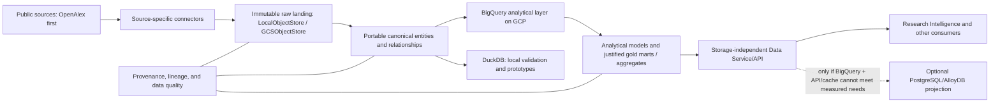

# Research Intelligence Data Platform

A local-first platform for public scholarly and research data, with **OpenAlex
first**, portable canonical schemas, and **BigQuery as the first analytical
implementation on GCP**. DuckDB supports local validation and prototyping.
PostgreSQL/AlloyDB is an optional operational projection, justified by benchmarks
rather than required by the target architecture.

Development uses public OpenAlex or synthetic data only. No Wiley enterprise
access, proprietary data, or cloud credentials are needed for the default tests.

## Current status

**Steps 01–21 are complete.** 21-step implementation/readiness roadmap
complete. Cloud runtime and deployment gaps remain explicitly documented; this
does not mean production-ready. Step 19 / #27 delivered the bounded end-to-end
pipeline (`research_platform.e2e`, local `SEMANTIC_ONLY`). Step 20 / #25
delivered orchestration contracts (`research_platform.orchestration`).
**Step 21 / #28 is complete, closed** (environment readiness contracts in
`research_platform.readiness`; Sandbox→DEV→QA→PROD matrix; no cloud
provisioning/deploy/PROD access). The full cloud/Airflow pipeline is not
implemented.

| Step | Delivered capability | Implementation boundary |
| --- | --- | --- |
| 01 | Repository foundation | Python packaging, typed interfaces, structured logging, tests, CI, and optional local PostgreSQL tooling |
| 02 | Configuration framework | Validated YAML, environment substitution, explicit environment selection, and strict sample limits |
| 03 | Storage contracts | `ObjectStore` and immutable-write semantics; `GCSObjectStore` adapter (#9) with offline fake-client tests; live smoke passed in GCP_SANDBOX (#91; least-privilege re-run in #108 Stage 1) and in personal projects labelled DEV and QA (#108 Stage 3), so `VERIFIED` there at domain level only |
| 04 | Warehouse contracts | Parameterized query/PyArrow interface; `DuckDBWarehouse` local queries (#8); `BigQueryWarehouse` (#10; live smoke passed in GCP_SANDBOX in #92 and #108 Stage 1, and in personal DEV/QA projects in #108 Stage 3, so `VERIFIED` there at domain level only); `PostgreSQLWarehouse` query (#7; `LOCAL_POSTGRES_VERIFIED` by #90) |
| 05 | Bounded OpenAlex connector | Anonymous manifest discovery and separate caller-owned streaming retrieval |
| 06 | Works manifest parser | Pure parsing, validated metadata, stable identities, and duplicate/conflict handling |
| 07 | Development sample selector | Deterministic, metadata-only selection with file-count and byte-size bounds |
| 08 | Bounded source profiling | One-file JSONL/JSONL.GZ streaming sample and footer-first Parquet profile with evidence-classified reports; real payload profiled only in a LOCAL bounded inspection (#126), not in any cloud environment |
| 09 | Immutable local raw landing | `LocalObjectStore` with atomic content/provenance publish, OpenAlex raw key layout, replay/conflict, and offline contract tests |
| 10 | Pipeline control contracts | `PipelineRun`, `SourceFileControl`, `RecordProvenance`, lifecycle/claim rules, `ControlStore` protocol, and versioned PostgreSQL DDL specs |
| 11 | Canonical OpenAlex model | Normalized entities/relationships, ID rules, PyArrow schemas, source mapping, lineage/version semantics; no ingestion |
| 12 | One-file local Works ingestion | Manifest → claim → immutable land → stream decode/map/upsert/provenance inside one Postgres txn → SUCCESS; `--backend memory|postgres`; offline + Postgres tests ([#20](https://github.com/agilandeenadhayalan41/research-intelligence-data-platform/issues/20)) |
| 13 | OpenAlex Works deletions | Public `data/jsonl/works/deleted_ids.csv.gz` (`work_id,deleted_date`) → claim → stream tombstones with per-row precedence; no silent resurrection; offline + Postgres tests ([#21](https://github.com/agilandeenadhayalan41/research-intelligence-data-platform/issues/21)) |
| 14 | Query-pattern + benchmark registry | Typed OpenAlex workload registry, grains, fan-out risks, evidence-honest placements, FIXTURE_ONLY local harness; no BigQuery deploy ([#19](https://github.com/agilandeenadhayalan41/research-intelligence-data-platform/issues/19)) |
| 15 | BigQuery-first analytical contracts | BigQuery Standard SQL DDL/queries, grains, partition/cluster, MERGE/refresh, cost rules, DuckDB `SEMANTIC_ONLY` validation; no GCP deploy or paid queries ([#22](https://github.com/agilandeenadhayalan41/research-intelligence-data-platform/issues/22)) |
| 16 | Gold analytical marts | Consumer Gold marts, grains, fan-out-safe SQL, ACTIVE/citation/license semantics, evidence-honest materialization candidates, DuckDB `SEMANTIC_ONLY`; no GCP deploy ([#55](https://github.com/agilandeenadhayalan41/research-intelligence-data-platform/issues/55)) |
| 17 | Data quality gates and metrics | HARD_GATE vs INFORMATIONAL_METRIC, canonical/relationship/reconciliation/Gold exclusion gates, DuckDB `SEMANTIC_ONLY` runner; no silent repair, no GCP deploy ([#24](https://github.com/agilandeenadhayalan41/research-intelligence-data-platform/issues/24)) |
| 18 | Data Service domain layer | Storage-independent capabilities, capability registry, typed request/response contracts, cursor pagination, freshness/`PUBLISHED_SNAPSHOT`, in-memory `SEMANTIC_ONLY` repository; no HTTP deploy, no raw SQL, no Postgres/AlloyDB serving ([#26](https://github.com/agilandeenadhayalan41/research-intelligence-data-platform/issues/26)) |
| 19 | Bounded end-to-end pipeline | One outer `PipelineRun`, reusable Step-12/13 stages, DuckDB `SEMANTIC_ONLY` analytical/Gold, real Step-17 gates, atomic local publication, Data Service final validation; no BigQuery/Airflow/GCP ([#27](https://github.com/agilandeenadhayalan41/research-intelligence-data-platform/issues/27)) |
| 20 | Orchestration contracts | Thin DAG + physical ExecutionUnits (REGISTER/INGEST/CANONICALIZE → one `WORKS_INGEST_UNIT`), bounded TaskMessage/XCom, recursive safe metadata, retries, backfill bounds, publication concurrency scope (`TEMP_TABLES` recommended), dry-run plan renderer; no Airflow/Composer/Dataform/GCP deploy ([#25](https://github.com/agilandeenadhayalan41/research-intelligence-data-platform/issues/25)) |
| 21 | Environment readiness | Truthful Sandbox→DEV→QA→PROD readiness registry, evidence levels, promotion gates, IAM/WIF/secrets/GCS/BigQuery gaps documented; no cloud provisioning ([#28](https://github.com/agilandeenadhayalan41/research-intelligence-data-platform/issues/28)) |

The boundary column records what each step itself delivered. Later validation
issues (#91, #92, #103, #108, #118) ran some of this code against GCP in
operator-run checks on synthetic or public sample data; see the paragraphs below
and [Roadmap completion status](#roadmap-completion-status).

Constructing adapters or loading configuration does not connect to services.
`LocalObjectStore` writes only under the configured local landing path. Default
ingestion tests stay offline (fake connector + in-memory control/canonical).
`GCSObjectStore` is implemented behind the existing `ObjectStore` contract
(create-only generation preconditions; default tests use an injected fake
client — no live credentials/network). Live bucket validation is separately
approved and is not part of default CI. #91 recorded a passing live sandbox
smoke, and #108 re-ran it as a least-privilege service account in GCP_SANDBOX
(Stage 1) and in operator-controlled personal projects labelled DEV and QA
(Stage 3). `GCS_RAW_LANDING` is therefore `VERIFIED` for GCP_SANDBOX, DEV and QA
at the domain level only; those environments stay `NOT_READY` overall, and the
personal projects are not enterprise-managed environments.

`BigQueryWarehouse` is implemented behind the existing `Warehouse` contract
(dry-run + `maximum_bytes_billed`; default tests use an injected fake client —
no live credentials/network/paid queries). Live dataset validation is
separately approved and is not part of default CI. #92 recorded a passing live
sandbox smoke of the adapter contract, and #103 deployed and MEASURED the models
in the sandbox on synthetic data only. #108 repeated both as a least-privilege
service account in GCP_SANDBOX (Stage 1) and in the personal DEV and QA projects
(Stage 3, synthetic-10k-works), and Stage 2 MEASURED the models in GCP_SANDBOX
at synthetic-100100-works. `BIGQUERY_ANALYTICAL` is therefore `VERIFIED` for
GCP_SANDBOX, DEV and QA at the domain level only.

`DuckDBWarehouse` implements local `Warehouse.query` for `:memory:` or an
explicit DuckDB file path. Construction does not open a connection or create a
file. Named values are driver-bound (`$name`; supplied `:name` placeholders are
rewritten to `$name` outside quotes and comments). Local DuckDB queries do not
prove BigQuery dialect, BigQuery cost, cloud readiness, or production readiness.

`PostgreSQLWarehouse` implements the same read `Warehouse.query` contract for
PostgreSQL (`%(name)s` placeholders, lazy DSN lookup, PyArrow results). Default
tests inject a fake connection. `make test-postgres-warehouse` is the separate
local PostgreSQL check and runs only when `POSTGRES_DSN` is set; issue #90
recorded it passing against local PostgreSQL 18.6 (`LOCAL_POSTGRES_VERIFIED`,
not cloud evidence). The adapter
is not the BigQuery analytical engine and does not implement issue #23
(PostgreSQL/AlloyDB serving). See
[PostgreSQL Warehouse](docs/architecture/postgres-warehouse.md).

**Still planned:** HTTP consumer deployment, Composer provisioning, and Dataform
runtime. The Step 15–16 BigQuery models were deployed and MEASURED on synthetic
data only, by the operator-run `scripts/bigquery_sandbox_103.py` (#103, #108).
Beyond those manual runs, the repository provisions no BigQuery dataset/table
estate, and there is no production pipeline. Steps 15–18 define
BigQuery/Gold/quality/Data Service contracts; default CI tests the runtime
adapters offline only. Separate runs outside default CI cover `GCSObjectStore`
(#91, #108), `BigQueryWarehouse` (#92, #103, #108, #118) and
`PostgreSQLWarehouse` (local PostgreSQL, #90). Step 20 adds orchestration
**contracts** only (no scheduler deploy). Step 18 adds no HTTP service and no
Postgres serving.

### Roadmap completion status

**Steps 01–21 ✅ complete.**

**Step 21 / [#28](https://github.com/agilandeenadhayalan41/research-intelligence-data-platform/issues/28)**
(complete, closed): environment readiness contracts
(`research_platform.readiness`) — Sandbox→DEV→QA→PROD matrix, evidence-honest
statuses, promotion gates. Docs/contracts only; no cloud provisioning, no PROD
access. See [Environment readiness](docs/architecture/environment-readiness.md).

21-step implementation/readiness roadmap complete. Cloud runtime and deployment
gaps remain explicitly documented; this does not mean production-ready.

```text
LOCAL (evidence only) → GCP_SANDBOX → DEV → QA → PROD
```

Today Sandbox/DEV/QA/PROD are all `NOT_READY` overall, and promotion is denied
at every step. GCS (#9) and the BigQuery adapter (#10) are `VERIFIED` at the
domain level in GCP_SANDBOX (#91/#92 live smokes as user ADC in an
operator-owned project; #108 Stage 1 re-ran them as a least-privilege service
account) and in operator-controlled personal projects labelled DEV and QA
(#108 Stage 3), and `BLOCKED` in PROD. The personal DEV/QA projects are not
enterprise-managed environments. The Step 15–16 BigQuery models were deployed
and MEASURED in GCP_SANDBOX on synthetic-10k-works (#103) and
synthetic-100100-works (#108 Stage 2), and in the personal DEV/QA projects on
synthetic-10k-works (#108 Stage 3); not at production scale and not on real
OpenAlex data. IAM / Composer / HTTP deploy gaps remain. Do not equate YAML
presence or adapter code with production readiness. For requirement-level
status against the lead architecture, see the
[OpenAlex lead coverage register](docs/requirements/openalex-lead-coverage.md).

[Issue #2](https://github.com/agilandeenadhayalan41/research-intelligence-data-platform/issues/2),
the roadmap umbrella, was closed as completed on 2026-10-13; new work needs its
own issue, and the Data Engineering follow-ups are tracked under
[#157](https://github.com/agilandeenadhayalan41/research-intelligence-data-platform/issues/157).
**#9** (GCS) and **#10** (BigQuery) adapter implementations are complete
(both closed); their live smokes passed in GCP_SANDBOX (#91, #92) and in the
personal DEV/QA projects (#108). **#7** (PostgreSQL)
and **#8** (DuckDB) query adapters are implemented; #7 is locally validated
against PostgreSQL by #90. Neither is cloud or production evidence.
[#23](https://github.com/agilandeenadhayalan41/research-intelligence-data-platform/issues/23)
(optional PostgreSQL/AlloyDB serving) was closed as not planned on 2026-10-13:
after #118 the operator chose BigQuery + API/cache for DOI and Work-ID lookups.
Its local Work lookup projection stays an unapproved, undeployed PROTOTYPE; reopen
#23 only under the criteria in its closing comment. Do not claim production
readiness.

## Target architecture

The following diagram is the **target**, not a claim that these components are
already running:



- **Preserve the source.** Immutable raw bytes and provenance must support replay
  without overwrites. Atomic publication and conflict handling belong in storage
  adapters.
- **Keep canonical data portable.** Model entities and relationships separately;
  do not create a giant flattened table or couple canonical schemas to a serving
  engine. Object storage plus Parquet is the canonical data layer (lead §3.1,
  §30); [ADR 0001 D1](docs/adr/0001-gcp-architecture-and-service-selection.md#d1-canonical-gcs-layout-and-release-manifests)
  selects the Cloud Storage Parquet release layout. DE-07 (#128) builds those
  releases from landed Bronze and tests them offline against local and fake
  Cloud Storage stores; no live run is recorded.
- **Start GCP analytics with BigQuery.** Derive partitioning, clustering, bounded
  scans, and materializations from query evidence. DuckDB results do not prove
  BigQuery SQL compatibility.
- **Measure before adding operational storage.** Benchmark latency, concurrency,
  freshness, frequency, scanned bytes, cost, and result size against BigQuery with
  an API/cache. Do not copy the full analytical relationship model into PostgreSQL.
- **Publish capabilities, not unrestricted SQL.** Future consumers should use
  storage-independent metadata lookup, journal metrics, and publisher analytics.
  Aggregate multi-valued relationships independently to avoid double counting.

See the [platform architecture](docs/architecture/platform-architecture.md),
[BigQuery-first guidance](docs/architecture/gcp-bigquery-first.md), and
[query-routing strategy](docs/architecture/query-routing.md) for the design
decisions and boundaries.

## Implemented OpenAlex flow

```text
Public Works manifest
  -> bounded manifest retrieval
  -> pure manifest parser
  -> deterministic bounded sample selector
  -> selected SourceAsset metadata
  -> explicit fetch() call
  -> caller-owned bounded source-byte stream
```

Discovery does not fetch source data files. Retrieval does not write raw data,
canonicalize records, load a warehouse, or run a pipeline.

| API | Responsibility |
| --- | --- |
| `OpenAlexAssetMetadata` | Validates source format, URI, dates, sizes/counts, and stable asset identity |
| `parse_openalex_works_manifest()` | Parses caller-provided JSON text, UTF-8 bytes, or a mapping without I/O |
| `select_openalex_works_sample()` | Returns selected metadata, configured bounds, eligibility counts, and safe skip reasons |
| `OpenAlexConnector.discover()` | Retrieves only the selected-format Works manifest and reuses the parser/selector |
| `OpenAlexConnector.discover_metadata()` | Returns the bounded selection with validated metadata; `discover()` delegates to it |
| `OpenAlexConnector.fetch()` | Returns a caller-owned binary stream with actual-byte enforcement and explicit failures |
| `profiling.profile_openalex_asset()` | Checks metadata, retrieves one bounded file, and returns an evidence-classified JSONL or Parquet profile |
| `openalex_raw_object_key()` | Builds a deterministic local raw content key from validated OpenAlex metadata |
| `LocalObjectStore.put_if_absent()` | Streams bytes, verifies SHA-256, and atomically publishes content + provenance |
| `LocalObjectStore.open()` | Returns a caller-owned read-only stream for a committed object |

The selector defaults are exactly `max_files=1` and
`max_file_size_bytes=25_000_000` (decimal bytes). Invalid limits are rejected, never
interpreted as unlimited. Unknown-size and oversized assets are excluded; eligible
assets are ranked smallest first with deterministic tie-breaking.

Manifest reads have a separate 1,000,000-byte cap. Payload retrieval uses bounded
reads, checks actual cumulative bytes independently of metadata, and uses a
one-byte probe to detect overflow. Responses are closed on EOF, caller close, or
failure. Request retries/timeouts are bounded, and returned streams are never
restarted after partial delivery.

The connector supports the current Works `jsonl` and `parquet` namespaces in the
public `openalex` bucket, mapped to the fixed `openalex.s3.amazonaws.com` HTTPS
host. It uses no AWS credentials, authenticated fallback, or redirects. The
default manifest endpoint is:

```text
https://openalex.s3.amazonaws.com/data/jsonl/works/manifest.json
```

OpenAlex documents gzip-compressed JSONL and Snappy-compressed Parquet.
Anonymous HEAD and bounded manifest-prefix observations verified metadata access
and the declared formats, not the payload codecs. The cloud-agent connectivity
attempt was separately blocked by its runtime firewall. See the
[OpenAlex contract](docs/architecture/openalex-manifest-contract.md) for dated
evidence, exact format/identity rules, error categories, and stream ownership.

The explicit network check reads only the bounded JSONL Works manifest:

```powershell
python -m research_platform.sources.openalex.connectivity
```

This command is **opt-in**, may fail under network restrictions, and is not part
of default tests or CI. It does not fetch a snapshot data file or contact GCP.

The separate, explicit Step 08 profile command reads both Works manifests, then
retrieves and profiles at most one bounded file (default 25,000,000 bytes, 100
sampled records):

```powershell
python -m research_platform.sources.openalex.profiling --format jsonl
```

It is also opt-in and excluded from tests/CI. See
[OpenAlex source profiling](docs/architecture/openalex-source-profiling.md) for the
evidence classes, bounds, verified representations, and format recommendation.

## Local development

Requires **Python 3.12+ and Make**. Docker Compose is optional and is not needed
for the default test suite. Dependencies and package metadata are defined in
[`pyproject.toml`](pyproject.toml): Pydantic, PyYAML, PyArrow,
`google-cloud-storage`, and `google-cloud-bigquery` at runtime, with pytest and
DuckDB for development and an optional `postgres` extra (psycopg) for the local
PostgreSQL checks. Direct dependencies are pinned; a complete transitive
lockfile is not provided.

From the repository root, create a virtual environment. In PowerShell:

```powershell
python -m venv .venv
.\.venv\Scripts\Activate.ps1
```

On Linux/macOS, activate the environment with `source .venv/bin/activate` instead.
Then use the existing Make targets:

```text
make install
make test
make check
make build
```

| Command | Purpose |
| --- | --- |
| `make install` | Install the package in editable mode with development dependencies |
| `make test` | Run default offline unit/integration tests (`-m "not postgres and not openalex_live and not gcs_live"`) |
| `make test-unit` | Run only unit tests (also excludes postgres) |
| `make test-gcs-live` | Opt-in live GCS landing checks (DE-06) that the repository owner runs in a project they control; never part of `make test` or CI |
| `make test-canonical-gcs-live` | Opt-in live Silver release checks (DE-07) that the repository owner runs in a project they control; never part of `make test` or CI |
| `make test-orchestration` | Focused Step 20 orchestration contract tests (also covered by `make test`) |
| `make test-postgres-ingestion` | Separately invoked local PostgreSQL Steps 12–13 transaction tests |
| `make test-postgres-warehouse` | Separately invoked local PostgreSQL `Warehouse.query` tests (#7) |
| `make test-postgres-serving` | Separately invoked local PostgreSQL tests for the #23 Work lookup projection PROTOTYPE |
| `make check` | Compile Python sources/tests and check installed dependency consistency |
| `make build` | Build a wheel into the ignored `dist` directory without building dependency wheels |
| `make postgres-up` / `make postgres-down` | Explicitly start/stop the optional local Compose service |

These commands come from the [Makefile](Makefile). `make check` is not a dedicated
linter, formatter, or static type checker; those targets do not currently exist.
For one focused test file in PowerShell:

```powershell
python -m pytest tests\unit\test_openalex_sample.py
```

Default tests use tiny synthetic data, fake HTTP clients/sockets, and local
DuckDB/PyArrow checks. They do not require cloud credentials, external services,
or public-source downloads. Durable Steps 12–13 PostgreSQL tests require
`POSTGRES_DSN` and `make test-postgres-ingestion` (skipped when unavailable).

The [Tests workflow](.github/workflows/tests.yml) runs install, check, test, and
wheel packaging on pushes and pull requests, using Python 3.12 and 3.14 on
`ubuntu-latest` with read-only repository permissions. It also checks that the
optional `postgres` extra resolves to binary wheels on each Python version. Required-check enforcement is a separate
GitHub repository setting, not established by the workflow file.

## Configuration and environments

Load one configuration explicitly; do not print configuration or environment
contents:

```python
from pathlib import Path

from research_platform.common.logging import configure_logging
from research_platform.config import load_config
from research_platform.sources.openalex import OpenAlexConnector

config = load_config(Path("config") / "local.yaml")
configure_logging(config.log_level)
connector = OpenAlexConnector(sample_selection=config.sample_selection)
```

This example does not discover or retrieve anything. The
[loader](src/research_platform/config/loader.py) resolves `${VARIABLE}` references
after safe YAML parsing; missing/empty referenced values fail explicitly.
[Pydantic models](src/research_platform/config/models.py) reject unknown settings
and invalid sample limits. Relative data paths are relative to the process
working directory. Python does not automatically load `.env`.

| Configuration | Current meaning |
| --- | --- |
| [`config/local.yaml`](config/local.yaml) | Local storage settings, in-memory DuckDB settings, and bounded sample defaults |
| [`config/gcp-sandbox.yaml`](config/gcp-sandbox.yaml) | GCS/BigQuery identifier shape from environment variables; no resources created |
| [`config/dev.yaml`](config/dev.yaml), [`config/qa.yaml`](config/qa.yaml), [`config/prod.yaml`](config/prod.yaml) | Local-only placeholders (local storage, DuckDB), not verified deployments |

No runtime factory selects a warehouse engine from these files.
`object_store_from_config` selects the landing store from `storage.backend`, and
the Step 12/13 runners use `gcs` only when a caller passes
`allow_gcs_landing=True` and an injected source connector with
`environment: gcp-sandbox` (DE-06, #127); the CLIs and the Step 19 runner refuse
non-local configuration. The recorded #103, #108 and #118 cloud runs
(GCP_SANDBOX and the personal DEV/QA projects) were driven by operator-run
scripts in `scripts/` with their own flags and `GOOGLE_CLOUD_PROJECT`, not by
loading these YAML files.

The scaffold still includes `warehouse.transactional: postgres`; no runtime code
reads that setting, and it does not make operational serving mandatory.
`GCSObjectStore` and `BigQueryWarehouse` are available with injectable clients
for offline tests. `DuckDBWarehouse` executes local queries only. Configuration
alignment and cloud runtime persistence require separately scoped work.

PostgreSQL has three separate roles here, each exercised only against local
PostgreSQL. None is a production control plane or an approved serving store:

- **Pipeline control and canonical state.** `ControlStore` has a fail-fast
  `UnimplementedControlStore`, an `InMemoryControlStore`, and the durable
  `PostgresControlStore` (with `PostgresCanonicalStore`) that the Step 12–13
  local pipelines use with `--backend postgres`. No production durable control
  state exists yet (tracked in
  [#133](https://github.com/agilandeenadhayalan41/research-intelligence-data-platform/issues/133)):
  [ADR 0001 D4](docs/adr/0001-gcp-architecture-and-service-selection.md#d4-durable-control-plane-cloud-sql-for-postgresql-control-state-only)
  selects Cloud SQL for PostgreSQL for control state only, adopted only after
  the DE-12 gates pass.
- **Read queries.** `PostgreSQLWarehouse` implements read `Warehouse.query`
  (offline by default; local PostgreSQL integration is separate and recorded by #90).
- **Optional serving.** Issue #23 has only a local PROTOTYPE work lookup
  projection (gate not met; see
  [Work lookup projection](docs/architecture/serving-work-lookup-projection.md)).
  No serving projection is approved or deployed, and #23 is closed as not planned.

#118 measured an in-process TTL/LRU cache (`serving/lookup_cache.py`) around
`BigQueryWarehouse.query` in the operator's personal DEV project on synthetic
~10k-Works tables. Against the operator-stated 200 ms p95 lookup target (not an
SLA), cold-cache DOI and Work-ID runs missed it (overall p95 2,426 ms and
2,554 ms) and prewarmed runs met it (0.006 ms and 0.010 ms). That is
measurement code, not a deployed cache or API; a production lookup cache is
tracked in
[#151](https://github.com/agilandeenadhayalan41/research-intelligence-data-platform/issues/151).

The sandbox template references `GOOGLE_CLOUD_PROJECT`, `GCS_BUCKET`, and
`BIGQUERY_DATASET`. Cloud adapters and scripts must obtain credentials through approved
environment/ADC or workload-identity mechanisms, never tracked credential files.
Sandbox -> DEV -> QA -> PROD is a future readiness path, not deployed infrastructure.

### Optional local PostgreSQL

The [Compose file](docker-compose.yml) provides PostgreSQL 16 for explicitly
requested local tooling only:

```powershell
if (-not (Test-Path .env)) { Copy-Item .env.example .env }
# Set a unique local POSTGRES_PASSWORD in .env before starting Compose.
make postgres-up
make postgres-down
```

Do not replace an existing `.env`. Compose binds only to `127.0.0.1`, requires a
non-empty password, and preserves its named volume on `postgres-down`. It does not
run migrations or ingest data. Never put a credential-bearing `POSTGRES_DSN` in
tracked YAML or logs.

## Documentation and repository map

| Document | Read it for |
| --- | --- |
| [Platform architecture](docs/architecture/platform-architecture.md) | Layers, responsibilities, and system boundaries |
| [GCP / BigQuery-first architecture](docs/architecture/gcp-bigquery-first.md) | Analytical strategy, cost safety, and optional operational storage |
| [Query routing](docs/architecture/query-routing.md) | Capability routing decision model (pre-registry) |
| [Query-pattern benchmarks](docs/architecture/query-pattern-benchmarks.md) | Step 14 registry fields, grains, fan-out, evidence, placement rules |
| [BigQuery analytical models](docs/architecture/bigquery-analytical-models.md) | Step 15 BQ DDL/SQL contracts, partition/cluster, MERGE, SEMANTIC_ONLY limits |
| [Gold analytical marts](docs/architecture/gold-analytical-marts.md) | Step 16 Gold grains, fan-out safety, materialization honesty, SEMANTIC_ONLY limits |
| [Data quality](docs/architecture/data-quality.md) | Step 17 HARD_GATE/metric registry, publication blocking, SEMANTIC_ONLY limits |
| [Orchestration](docs/architecture/orchestration.md) | Step 20 thin DAG, TaskMessage/XCom, retries, publication scope, Airflow mapping (no deploy) |
| [Environment readiness](docs/architecture/environment-readiness.md) | Step 21 Sandbox→DEV→QA→PROD readiness matrix, promotion gates, cloud gaps |
| [Enterprise environment inventory](docs/operations/enterprise-environment-inventory.md) | DE-04 (#125) non-secret record of the approvals that enterprise-managed GCP_SANDBOX, DEV and QA need, by owner role; changes no readiness level |
| [Public data sources](docs/architecture/public-data-sources.md) | Source priorities and source-specific normalization |
| [OpenAlex contract](docs/architecture/openalex-manifest-contract.md) | Implemented metadata, parser, selector, connector, and public-access evidence |
| [OpenAlex source profiling](docs/architecture/openalex-source-profiling.md) | Bounded profiler, evidence classes, verified representations, and format decision |
| [Immutable local landing](docs/architecture/immutable-local-landing.md) | Raw key layout, atomic publish, replay/conflict, open integrity |
| [Pipeline control](docs/architecture/pipeline-control.md) | Control models, lifecycle, claims, idempotency, ControlStore boundary |
| [PostgreSQL Warehouse](docs/architecture/postgres-warehouse.md) | #7 read-query adapter, placeholders, Arrow types, lazy DSN, #23 boundary |
| [OpenAlex canonical model](docs/architecture/openalex-canonical-model.md) | Normalized entities/relationships, IDs, mapping, PyArrow contracts |
| [OpenAlex deletions](docs/architecture/openalex-deletions.md) | Tombstones, precedence/restore, deletion lineage, transaction boundary |
| [21-step roadmap](docs/architecture/roadmap.md) | Completed stages and separately scoped future work |
| [OpenAlex lead coverage register](docs/requirements/openalex-lead-coverage.md) | Requirement-level status of the lead architecture (Sections 1–30): implementing files, tests, evidence strength, gaps, and owning follow-on issues |
| [Architecture decision records](docs/adr/README.md) | ADR index and process; ADR 0001 (#124; its status is in the index) records the GCP service selection and the options not selected, with revisit triggers |
| [Copilot instructions](.github/copilot-instructions.md) | Engineering rules, phase boundaries, and required validation |

```text
config\                       Local and future environment templates
config\query-patterns\        OpenAlex query-pattern registry YAML (Step 14)
src\research_platform\
  common\                     Structured JSON logging
  config\                     Validated models and explicit YAML loading
  sources\openalex\            Metadata, parser, selector, connector, profiler, connectivity/profile CLIs
  storage\                    ObjectStore contract; LocalObjectStore; GCSObjectStore
  control\                    Pipeline-control models, lifecycle, ControlStore protocol, in-memory store
  canonical\openalex\         Portable OpenAlex canonical models, schemas, mapping, Parquet export, Silver releases
  persistence\                Unit-of-work boundaries; local durable PostgresControlStore/PostgresCanonicalStore
  ingestion\                  Step 12–13 local Works ingestion and deletions pipelines and CLIs
  benchmarks\                 Query-pattern registry models, fan-out fixtures, FIXTURE_ONLY harness
  analytics\bigquery\         Step 15 BigQuery table/query contracts + offline validation
  analytics\gold\             Step 16 Gold mart contracts + SEMANTIC_ONLY validation
  quality\                    Step 17 data-quality gates, metrics, SEMANTIC_ONLY runner
  service\                    Step 18 Data Service domain layer, in-memory repository (no HTTP)
  e2e\                        Step 19 bounded SEMANTIC_ONLY composition runner
  orchestration\              Step 20 thin DAG / TaskMessage / retry / publication-scope contracts
  readiness\                  Step 21 environment readiness registry + promotion gates
  warehouse\                  Warehouse contract; BigQueryWarehouse; DuckDBWarehouse; PostgreSQLWarehouse
  provenance\                 Immutable retrieval-provenance model
  serving\                    #118 in-process lookup cache; #23 Work lookup PROTOTYPE (unapproved, not deployed)
tests\                        Offline unit/integration tests and synthetic fixtures
docs\architecture\            Architecture, contracts, source strategy, roadmap
docs\overview\                Overview pages: introduction, getting started, how it works, status, glossary
docs\requirements\            OpenAlex lead coverage register and traceability matrices
docs\site\                    Docusaurus project that renders docs\ (PRs #158/#159)
sql\control\                  Versioned PostgreSQL control DDL (applied by --backend postgres local ingestion)
sql\canonical\                Versioned PostgreSQL canonical DDL (applied by --backend postgres; not BigQuery)
sql\serving\postgres\         #23 PROTOTYPE Work lookup projection DDL (local only)
sql\bigquery\openalex\        BigQuery Standard SQL DDL, MERGE models, pattern queries, gold marts, quality (deployed and run only by operator scripts, on synthetic data: GCP_SANDBOX, personal DEV/QA)
scripts\                      Manual, operator-run cloud smoke and measurement scripts (offline tests use fakes; live runs are never part of make test or CI)
dags\                         Reserved for later orchestration; empty
infrastructure\terraform\     Reserved infrastructure; no provisioned resources
data\                         Ignored runtime-data locations; no committed datasets
```

Reserved directories are not delivered workloads. The Docusaurus site source is
in `docs/site/` (PRs #158/#159). Airflow/Composer, Dataform coordination,
Terraform resources, and deployed APIs remain future work.

## Public-data and delivery boundaries

OpenAlex is the only implemented source connector. AACT/ClinicalTrials is next
in the [source priority](docs/architecture/public-data-sources.md), but no open
issue tracks it, and the Data Engineering issues (#122–#156) are OpenAlex-only;
OpenFDA, grants, patents, news/releases, and other public datasets remain future
extensions. Each needs its own verified source contract
and normalization; the OpenAlex schema must not be imposed on other sources.

- Work in small, explicitly selected phases. For code changes, run `make test`,
  `make check`, and `make build`; resolve failures before presenting the PR.
- Never commit credentials, `.env`, service-account JSON, or downloaded datasets.
  Keep credential files outside the repository. Do not hardcode cloud project IDs
  or log credentials, DSNs, environment contents, or sensitive payloads.
- Preserve raw bytes and immutable provenance. Future ingestion must attach run
  identity, source URI, retrieval time, and a checksum calculated from actual bytes;
  a metadata-derived asset ID is not a payload checksum.
- Do not access production, create cloud resources, or start other roadmap tasks
  without explicit authorization. A configuration template is not proof of access,
  readiness, or deployment.
- Do not implement Wiley content ingestion, internal services, LLM/ML/GenAI/NLP,
  embeddings, or knowledge graphs as part of the current platform stages. Future
  consumers remain separate from this repository's delivered capabilities.
