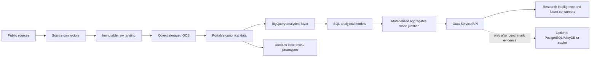

# GCP: BigQuery-first analytical architecture

BigQuery is the primary first analytical implementation on GCP. The
`GCSObjectStore` (#9) and `BigQueryWarehouse` (#10) runtime adapters are
implemented and passed live smokes (#91, #92). Operator-run scripts created the
Step 15 tables in operator-created datasets and executed and measured the
Step 15–16 SQL on synthetic data only, in GCP_SANDBOX (#103, #108 Stages 1–2)
and in operator-controlled personal projects labelled DEV and QA (#108 Stage 3).
The repository provisions no cloud infrastructure, has no deployment pipeline,
and nothing is deployed to an enterprise environment or PROD.
Configure environments explicitly, default to local resources, and do not
access production or create expensive cloud resources during development.

## Target flow

## Design principles

- Keep immutable raw objects and provenance in object storage; use versioned
  paths, checksums, and explicit replay/conflict semantics. Do not overwrite raw
  source bytes.
- Keep canonical schemas portable and independent of BigQuery or PostgreSQL.
  Use Parquet where genuinely applicable and preserve normalized relationships.
- Use BigQuery for analytical workloads and high-volume relationships. Base
  partitioning, clustering, and query design on measured workloads; bound queries
  and consider data scanned and cost.
- Keep SQL dialects explicit. DuckDB supports local analytical testing but does
  not prove BigQuery dialect compatibility. Bind values instead of interpolating
  untrusted inputs.
- Expose domain capabilities through a storage-independent Data Service/API.
  Materialize repeated expensive outputs only when usage justifies their
  maintenance and cost.
- Assess PostgreSQL/AlloyDB only after benchmarking representative point lookups,
  expected concurrency, and freshness against BigQuery with API/cache. If needed,
  use it as a selective operational projection; do not copy every analytical
  relationship by default.
- Keep Spark/Dataproc and Iceberg/BigLake optional future choices. Revisit them
  only if measured volume, transformation complexity, ACID/time-travel needs,
  schema evolution, or multi-engine requirements warrant them.

Runtime code that exists today: `GCSObjectStore` (#9), `BigQueryWarehouse`
(#10), the `PostgreSQLWarehouse` read adapter (#7), the local PostgreSQL
control and canonical stores behind the Step 12/13 pipelines, and an in-process
lookup cache built for the #118 measurement. The local PostgreSQL Work lookup
projection is an unapproved prototype, and #23 was closed as not planned in
favour of BigQuery plus API/cache. AlloyDB, Spark, Dataproc and Iceberg/BigLake
are not implemented.
