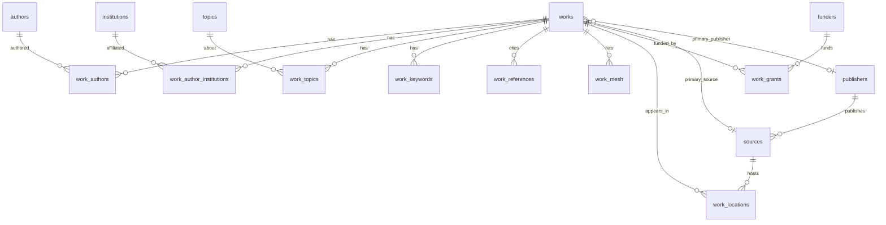

# OpenAlex canonical logical model (Step 11)

Step 11 defines a **normalized, portable** OpenAlex canonical model. It does not
implement ingestion, BigQuery physical design, PostgreSQL serving, or GCS.

Portable contracts live in `research_platform.canonical.openalex`:

| Module | Role |
| --- | --- |
| `identifiers.py` | Explicit ID normalization |
| `models.py` | Validated entity/relationship models |
| `schemas.py` | PyArrow interchange schemas (source of truth) |
| `mapping.py` | Source Work JSON → canonical bundle |
| `versioning.py` | Work update precedence (used by the Step 12 canonical stores) |
| `reconciliation.py` | Shared-entity reconciliation across Works |
| `field_catalog.py` | SUPPORTED / DEFERRED / UNMAPPED / SOURCE-ONLY |
| `export.py` | Local Parquet export with the pinned writer options |
| `lineage_codec.py` | Lineage flattening, moved out of `persistence/postgres` (DE-07) |
| `manifest.py` | Silver release manifest, publication record, `schema_major` and schema fingerprints |
| `rebuild.py` | Replay of landed Bronze inputs |
| `publisher.py` | Build, validate and reconcile Silver releases; publication-record writer |

Optional local SQL review DDL: [`sql/canonical/001_openalex_canonical.sql`](../../sql/canonical/001_openalex_canonical.sql)
(**PostgreSQL 16+** only). Since Step 12 it is also the schema that
`apply_ingestion_schema` applies for the local `PostgresCanonicalStore`. It is
not the BigQuery model, which lives under `sql/bigquery/openalex/` (see
[BigQuery analytical models](bigquery-analytical-models.md)).

The package also holds `errors.py` (typed modeling errors), `deletions.py` and
`activity.py` (Step 13 tombstones and active filtering, #21), and `export.py`,
the canonical Parquet exporter used by the #103/#108 BigQuery loads on
synthetic data (PRs #104/#105). Since DE-07 (#128) the package also builds
Silver releases; see [Canonical Parquet releases](#canonical-parquet-releases-de-07-128).

## Evidence basis

Mapping follows public OpenAlex Works API documentation and repository Step 08
notes. Real payloads were profiled only in a LOCAL bounded inspection on
2026-10-16 (#126; sandbox container, not cloud evidence). That inspection found
that the unchanged mapper rejected all 2,798 records of the profiled 2026-09-28
file: `created_date` and `updated_date` are ISO timestamps, not `YYYY-MM-DD`, and some
`host_organization` values are institution (`I…`) ids; both are handed to DE-10
(#131) and DE-08 (#129). Real Works also carry 15 top-level keys that
`FIELD_CATALOG` does not list, and the catalogued `grants` is absent (DE-10,
#131). Fields that cannot be mapped confidently are not guessed.
`FIELD_CATALOG` classifies the source fields it knows about (supported,
deferred and source-only), but it is reference data: the mapper does not read
it, and source fields it does not list, such as `primary_topic`, are ignored
rather than catalogued (unknown-field handling is tracked in #131).

## Identifier normalization

| Identifier | Canonical form | Also accepts |
| --- | --- | --- |
| OpenAlex entity | `W123`, `A123`, `I123`, `S123`, `P123`, `T123`, `F123` | `https://openalex.org/W123` |
| Keyword | `keywords/<slug>` | full OpenAlex keyword URL |
| DOI | lowercase bare DOI | `https://doi.org/...` |
| ORCID | bare `NNNN-NNNN-NNNN-NNNC` (uppercase `X` check character) | `https://orcid.org/...` and `http://orcid.org/...` |
| ROR | bare ROR id | `https://ror.org/...` |
| ISSN / ISSN-L | `NNNN-NNNC` | spaces removed and lowercase `x` uppercased; a value without the hyphen is rejected. The mapper normalizes `issn_l` only |

Malformed **work** ids fail mapping. Malformed **referenced_works** entries become
`work_references` rows with `reference_status=MALFORMED` (not dropped silently).
Identifiers are never fabricated.

## Entity grains and keys

| Entity | PK | Notes |
| --- | --- | --- |
| `works` | `work_id` | Core bibliographic attributes + array presence flags + lineage |
| `authors` | `author_id` | Shared; see reconciliation |
| `institutions` | `institution_id` | Shared; see reconciliation |
| `sources` | `source_id` | ISSN-L; `host_publisher_id` when present |
| `publishers` | `publisher_id` | Separate from free-text host name |
| `topics` | `topic_id` | Shared; see reconciliation |
| `funders` | `funder_id` | Shared; see reconciliation |

## Relationship grains

Relationship identity uses **source-array ordinals** so nullable semantic fields
remain null. There is no hidden `None` ↔ `""` conversion for portable keys.

| Relationship | Grain / uniqueness | Preserves |
| --- | --- | --- |
| `work_authors` | `(work_id, authorship_index)` | author order, corresponding flag, author id |
| `work_author_institutions` | `(work_id, authorship_index, institution_index)` | author↔institution association |
| `work_topics` | `(work_id, topic_id)` | optional score; duplicate topic ids deduped |
| `work_keywords` | `(work_id, keyword_id)` | optional score; duplicate keyword ids deduped |
| `work_references` | `(work_id, reference_index)` | source position; `referenced_work_id` nullable |
| `work_mesh` | `(work_id, mesh_index)` | `qualifier_ui` nullable; no empty-string sentinel |
| `work_locations` | `(work_id, location_index)` | `location_origin`; optional `source_id` |
| `work_grants` | `(work_id, grant_index)` | `funder_id` / `award_id` nullable; source duplicates kept |

Authorship example:

```text
Work W1
  authorship_index=0 author A -> institutions I1, I2
  authorship_index=1 author B -> institution I3
```

Yields 2 `work_authors` rows and 3 `work_author_institutions` rows. It does **not**
emit a denormalized authors×institutions×topics product.

### WorkReference replay-safe grain

Every `referenced_works` array slot maps to one row keyed by
`(work_id, reference_index)`:

- duplicate resolved ids keep distinct indexes (source multiplicity preserved)
- `MALFORMED` and `MISSING` rows keep identity without fabricating OpenAlex ids
- `referenced_work_id` stays null when unresolved

### Null-preserving relationship keys

PyArrow is authoritative. Review DDL matches nullability:

- `WorkMesh.qualifier_ui` — nullable in model, Arrow, and PostgreSQL
- `WorkGrant.funder_id` / `award_id` — nullable in model, Arrow, and PostgreSQL

Primary keys use ordinals (`mesh_index`, `grant_index`, `reference_index`) so a
PostgreSQL PK never forces empty-string stand-ins for null semantics.

## Missing vs null vs empty

| Source observation | `*_presence` | Relationship rows |
| --- | --- | --- |
| key absent | `MISSING` | 0 |
| key: null | `NULL` | 0 |
| key: [] | `EMPTY` | 0 |
| key: […​] | `PRESENT` | one row per element (after documented dedupe) |

Empty arrays never become a single NULL relationship row.

### `locations_presence` vs `primary_location`

`locations_presence` describes **only** the source `locations` field:

| Source `locations` | `locations_presence` |
| --- | --- |
| missing | `MISSING` |
| null | `NULL` |
| [] | `EMPTY` |
| non-empty array | `PRESENT` |

`primary_location` must **not** rewrite `locations_presence`.

When `locations` is absent, null, or empty, and `primary_location` is an object,
the mapper may still emit one `WorkLocation` with
`location_origin=PRIMARY_LOCATION_FALLBACK` and `is_primary=true`. That fallback
is explicitly distinguished from rows observed in `locations`
(`location_origin=LOCATIONS_ARRAY`). Fallback never invents a presence of
`PRESENT` for a missing/null/empty `locations` array.

## Shared-entity reconciliation

Authors, institutions, sources, publishers, topics, and funders can appear in
multiple Works. `reconcile_shared_entity` / `merge_shared_entity` define
deterministic outcomes **separate from** Work version precedence
(`compare_work_versions`).

| Situation | Outcome |
| --- | --- |
| same id + identical payload fields | `IDENTICAL` |
| same id + complementary null/non-null, no non-null conflicts | `ENRICH` |
| same id + conflicting non-null values, incoming `source_updated_date` newer | `NEWER` |
| same id + conflicting non-null values, incoming older | `STALE` |
| same id + conflicting non-null values, equal/undated versions | `CONFLICT` |

Rules:

- Do not silently overwrite a richer entity with a poorer embedded summary.
- `ENRICH` merges by keeping non-null values from either side (`merge_shared_entity`).
- Conflicting non-null fields never merge; callers decide using `NEWER` /
  `STALE` / `CONFLICT`.
- Work checksum/date precedence remains in `versioning.py` and is not reused as
  a silent last-writer-wins rule for shared entities.

## Date normalization

`_parse_date` accepts **only** exact `YYYY-MM-DD` calendar-date strings (or a
Python `date`). It rejects:

- timestamps / `datetime` values
- truncated prefixes of longer strings
- trailing garbage after a date
- invalid calendar dates

OpenAlex Work `publication_date`, `created_date`, and `updated_date` are modeled
as calendar dates in this contract. No silent `text[:10]` truncation.

## Version / deletion semantics (Works)

`CanonicalLineage` attaches nested `source_asset_id`, `source_checksum_sha256`,
`source_updated_date`, `run_id`, `processed_at`, `activity_state`, `deleted_at`.

Flattened portable PyArrow / SQL physical columns rename the lineage date to
`lineage_source_updated_date` so it never collides with entity fields such as
`Work.source_updated_date` (PostgreSQL and BigQuery both use this distinction).
Nested Pydantic access remains `work.lineage.source_updated_date`.

`compare_work_versions(existing, incoming)`:

1. same checksum → `IDENTICAL`
2. compare lineage `source_updated_date` (fallback Work record date) → `NEWER` / `STALE`
3. equal dates, different checksum → `CONFLICT`
4. undated mismatch → `CONFLICT`

Deletion processing is Step 13; this step only models `ACTIVE` / `DELETED`.

## ER diagram



## Field support summary

See `FIELD_CATALOG` in code. Highlights:

- **SUPPORTED:** id, doi, title/display_name, dates, type, language, citation
  counts, open_access, authorships (+ institutions), topics, keywords, mesh,
  referenced_works, locations/primary_location, grants, created/updated dates
- **DEFERRED:** concepts, related_works, abstract_inverted_index, biblio,
  secondary ids (PMID/PMCID/MAG), APC, SDGs, best_oa_location
- **SOURCE_ONLY:** is_retracted, is_paratext, has_fulltext (not copied yet)

## Lineage integration with Step 10

Canonical rows carry the same asset checksum / run identity concepts as
`RecordProvenance` and immutable `IngestionProvenance`. Step 12 local ingestion:

1. land raw bytes + `IngestionProvenance` (outside the DB transaction)
2. in one DB transaction, decode and map each record through `map_openalex_work`
3. in that same transaction: canonical upsert + `RecordProvenance` + source-file SUCCESS

Durable writes use `PostgresCanonicalStore` when selected; they do not go through
`Warehouse.query`. It is a local durable adapter for the Step 12/13 pipelines,
not a serving store. See [local Works ingestion](local-works-ingestion.md).

## Canonical Parquet releases (DE-07, #128)

A Silver release is an immutable, full-snapshot copy of the canonical tables in
object storage, built only from landed Bronze objects. It is the form that
[ADR 0001 D1](../adr/0001-gcp-architecture-and-service-selection.md#d1-canonical-gcs-layout-and-release-manifests)
makes the system of record. DE-07 builds and tests releases offline, against
`LocalObjectStore` and an in-memory fake of Cloud Storage; no live run is
recorded. A release whose manifest exists and validates is complete. It is not
published: consumers see a release only when the control-plane release pointer
selects it, and that pointer is DE-12 (#133).

| Module | Role |
| --- | --- |
| `storage/canonical_layout.py` | Release id rule and object keys |
| `canonical/openalex/manifest.py` | Release manifest and publication-record models, `schema_major`, schema fingerprints, the `work_deletion_barriers` schema |
| `canonical/openalex/rebuild.py` | Replays the listed Bronze inputs into a fresh in-memory store |
| `canonical/openalex/publisher.py` | Builds, validates and reconciles a release; writes publication records |
| `canonical/openalex/lineage_codec.py` | Lineage flattening, moved out of `persistence/postgres` |

**Layout.** Every object owns its directory, as on the Bronze side:

```text
openalex/canonical/schema_major=<n>/release_id=<id>/<table>/part-<nnnnn>/part-<nnnnn>.parquet
openalex/canonical/schema_major=<n>/release_id=<id>/manifest/manifest.json
openalex/canonical/publications/<sequence>-<release_id>/<sequence>-<release_id>.json
```

ADR 0001 D1 writes `<table>/part-<nnnnn>.parquet`, `manifest.json` at the
release root and `publications/<sequence>-<release_id>.json`.
`LocalObjectStore` keeps one object per directory, so each object gets its own
leaf directory; the manifest therefore lives at `manifest/manifest.json`, and
readers build that key with `canonical_manifest_key`. Readers never list or
glob: they open the manifest for a `release_id` and follow its relative paths.
A release directory can hold part files that no manifest lists (an interrupted
build), so a wildcard over a release directory is never a valid way to read it.

**Release id.** `<yyyymmddThhmmssZ>-<build run id as 32 hex digits>`, for example
`20261002T000000Z-00000000000000000000000000000001`. It comes from the build run
and its UTC start time (whole seconds), never from the content, so ids sort by
time and stay under 128 characters. Retrying the same build run with the same
`built_at` (the timestamp in the id) reuses the id. The caller persists
`built_at` with its build run; enforcing one release per build run is the
DE-12/DE-20 control plane's job.

**Tables.** The 15 `CANONICAL_SCHEMAS` tables plus `work_deletion_barriers`
(`work_id`, `deleted_date`, both required). The barrier table holds every entry
of the store's deletion-barrier map, including tombstoned Works, so the manifest
records `barrier_count` and `barrier_only_count` (barriers with no Work row). It
is a release-only table: `CANONICAL_SCHEMAS`, the BigQuery contracts and the DDL
are unchanged. Tombstoned Works and their preserved relationship rows are in the
release; the manifest counts those relationship rows per table.

**Parts.** Each table is split, in grain order, into parts of at most
`rows_per_part` rows (default 500,000), encoded one row group of
`row_group_size` rows (default 100,000) at a time. Both defaults are unmeasured
starting points, and both are recorded in the manifest because part bytes depend
on them. Parts use the option set of `export.py`; unlike a local export they set
an explicit row-group size and carry three footer keys: the table name,
`schema_major` and the table's schema fingerprint. Nothing release-specific is
in a part, so equal rows in equal part boundaries give equal bytes in any
release. Part boundaries are row-count slices, so one new Work usually shifts
later boundaries and parts are rarely shared between releases. An empty table
gets one part with no rows.

**Manifest.** `manifest.json` is written last and is the only entry point. It
records the release id, the parent release id, `schema_major` (1) and a SHA-256
fingerprint of each table's schema, the build run id and time, the package
version and a git revision when the caller passes one (otherwise the revision is
recorded as unknown), the Python, PyArrow and pydantic versions, the writer
settings with the full Parquet option set, and the decode limits used. It lists
every Bronze input in application order, which is increasing `processed_at`:
entity, asset id, run id, `processed_at`, the landing manifest key and its
SHA-256, the raw key, SHA-256 and size, the partition dates, the number of
non-blank raw lines and the outcome counts of that input. It lists every part
(path, SHA-256, bytes, rows, row groups), the row count, `activity_state`
counts and rows of tombstoned Works of each table, the barrier counts, a content
fingerprint over all part digests and an intent digest over everything a build
was asked to do. The source-rights field names ADR 0001 D12 (a) and points to
the DE-05 source record; it does not claim that the OpenAlex terms of use are
verified. Change sets are DE-11 (#132); the field is always empty. The manifest
holds no bucket, project, URL or local path.

**Writes.** Every object goes through `ObjectStore.put_if_absent`, so nothing is
overwritten, and every part's provenance carries the build's intent digest. A
retry of the same build run and `built_at` is therefore an identical replay or a
conflict: an identical build of a complete release checks that every listed part
is present and returns `existing_kept` without writing; any other build under
the same release id raises `ReleaseConflictError` and keeps what is stored. A
build that stops before the manifest leaves a release that no reader can open;
retrying the same build run and `built_at` with the same inputs completes it. A
retry that finds a stored part after a table's last rendered part (an earlier
attempt rendered more parts) raises `ReleaseConflictError` instead. A new
release can name a parent: an older release whose manifest is readable under the
same `schema_major` and records the same table schemas, and whose inputs are the
first inputs of the new release.

**Publication records.** `write_publication_record` writes the create-only record
that ADR 0001 D1 describes, after checking that the named release's manifest
exists and has the recorded SHA-256. Nothing in DE-07 calls it: the publication
unit calls it after the DE-12 pointer moves, so a record never runs ahead of the
pointer. Finding the highest record needs a listing, which `ObjectStore` does
not offer; that reader belongs with the pointer restore in DE-12.

**Visibility and rollback.** A release is complete only when its manifest exists
and validates. Building a new release changes nothing in earlier releases, so
the previous release stays readable. Choosing which release consumers see, and
rolling back, is the DE-12 pointer; nothing in DE-07 deletes a release.

### Rebuild and reconcile a release

The Done check of #128 is that a release can be reproduced from landed source
without BigQuery or PostgreSQL. `reconcile_release` reproduces a release from
the landed Bronze objects its manifest lists, using the manifest's recorded
inputs and writer settings, under the recorded PyArrow version and Parquet
options and with unchanged mapping code. It reads two object stores: Bronze,
holding the raw objects and landing manifests, and Silver, holding the release.
The manifest is needed: without it, a new release can be built from Bronze, but
the old one cannot be reproduced byte for byte.

1. It opens the manifest and validates every part against it: SHA-256, size,
   rows, row groups, footer, schema fingerprint and `activity_state` counts.
2. It refuses to compare when the installed PyArrow version, the Parquet option
   set or the table schemas differ from the manifest, because Parquet bytes
   depend on them. Rebuild in an environment with the pinned dependencies.
3. It replays the listed inputs in order into an empty in-memory store, with the
   run id and `processed_at` the manifest records for each input. It checks each
   landing manifest against its recorded SHA-256, each raw object against its
   recorded SHA-256 and size, and each input's decoded record count against a
   separate count of its raw lines. It never fetches from OpenAlex and never
   writes to either store.
4. It encodes the rebuilt tables with the manifest's writer settings and compares
   every part's SHA-256 and row count, each table's row, `activity_state` and
   tombstoned-Work row counts, the barrier counts, each input's outcome counts
   and the content fingerprint.

A missing or changed Bronze input, a corrupt part or a failed replay raises a
typed error. Any compared difference makes `report.passed` false and lists the
failing checks in `report.mismatches`; `report.raise_for_mismatch()` turns that
into `ReconciliationMismatchError`. Reconciliation shows that the release equals
what its listed inputs produce; it does not show that the list holds every input
the control plane marked successful. A local run:

```python
from pathlib import Path

from research_platform.canonical.openalex.publisher import reconcile_release
from research_platform.config.models import StorageConfig
from research_platform.storage.local import LocalObjectStore

bronze = LocalObjectStore(StorageConfig(backend="local", landing_path=Path("/path/to/bronze")))
silver = LocalObjectStore(StorageConfig(backend="local", landing_path=Path("/path/to/silver")))
report = reconcile_release(bronze=bronze, silver=silver, release_id="20261002T000000Z-00000000000000000000000000000001")
print(report.summary())
report.raise_for_mismatch()
```

`report.summary()` holds counts, digests, the manifest SHA-256 and the outcome,
and no keys or paths. Against Cloud Storage, build both stores with
`object_store_from_config`; the separate Bronze and Silver bucket bindings
arrive with DE-13 (#134).

**Evidence.** LOCAL: offline tests in default CI on synthetic Works and deletion
assets landed through the Step 12/13 pipelines
(`tests/unit/test_canonical_release.py`). Real OpenAlex records cannot be
released yet, because the canonical mapper rejects them (DE-10, #131, and DE-08,
#129). No `CLOUD_*` evidence exists until the opt-in live test below is run and
recorded.

**Opt-in live test.** `tests/integration/test_canonical_gcs_release.py` (marker
`gcs_live`, `make test-canonical-gcs-live`) lands synthetic inputs and builds,
replays, conflicts, rebuilds and extends one release in an existing bucket the
repository owner controls, under `de07-live/<run-token>/`, with at most 48
writes of at most 256 KiB each and at most 1,000 HTTP requests. It needs
`GOOGLE_CLOUD_PROJECT`, `GCS_LIVE_CONFIRM_PROJECT`, `GCS_LIVE_BUCKET`,
`GCS_LIVE_CONFIRM_BUCKET`, `GCS_LIVE_PROJECT_CLASS` and `GCS_LIVE_EVIDENCE_DIR`
(outside the repository). Post `summary.json` only. A run gives single-bucket
operator or personal evidence; a Silver bucket in an enterprise project still
needs `resource-location-policy`, `silver-bucket` and
`two-buckets-per-environment` approved.

**Not in DE-07.** The release pointer, the release registry and finding the
latest publication record (DE-12, #133), change sets (DE-11, #132), loads from
releases into BigQuery (DE-14, #135), bucket settings and retention periods
(DE-24, #145), the identities that read Bronze and garbage-collect Silver
(DE-23, #144; Silver garbage collection itself has no owner yet), the two
bucket bindings (DE-13, #134), streaming from a durable store and memory sizing
(DE-09, #130, and DE-20, #141), and when `schema_major` changes and which older
schemas a reader accepts (DE-10, #131). The in-memory store still bounds
release size.

## Out of scope

Step 11 scope: deletion processor (#21), BigQuery runtime (#22), GCS (#9),
Airflow, AACT/other sources, ML/KG. No BigQuery physical design in this step.
Silver releases: see above.
