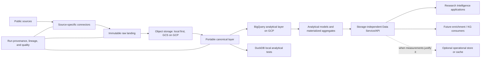

# Public Research Intelligence Data Platform

This repository is the beginning of a reusable platform for governed external
research data. OpenAlex is the first source. Each source has its own connector
and source-specific normalization into portable canonical schemas.

## Platform flow

The diagram describes the target architecture. The current foundation includes
configuration, contracts, bounded OpenAlex discovery/retrieval/profiling,
immutable **local** raw landing (`LocalObjectStore`), pipeline-control/provenance
contracts with in-memory and local PostgreSQL control stores, the portable
OpenAlex **canonical model**, one-file local Works and deletion ingestion
(Steps 12–13), BigQuery analytical, Gold and data-quality contracts
(Steps 15–17), the storage-independent Data Service **domain layer** (Step 18),
a bounded local end-to-end pipeline (Step 19), orchestration contracts
(Step 20), the readiness assessment (Step 21), and tests. The `GCSObjectStore`
(#9) and `BigQueryWarehouse` (#10) runtime adapters exist and have run against
real GCS and BigQuery in GCP_SANDBOX and in operator-controlled personal
projects labelled DEV and QA (#91, #92, #103, #108), on synthetic data and, in
the first BigQuery smoke (#92), a public sample table; never on real OpenAlex
data. Ingestion still lands to local storage only. Beyond those operator-run
checks, nothing is deployed: there is no HTTP Data Service/API, no scheduler
or DAG, no repository-provisioned cloud infrastructure and no downstream
consumer, and every environment is
`NOT_READY` overall ([environment readiness](environment-readiness.md)). See
[immutable local landing](immutable-local-landing.md),
[pipeline control](pipeline-control.md), and
[OpenAlex canonical model](openalex-canonical-model.md).

## Layer responsibilities

- **Discovery and connectors:** discover source data and retrieve bounded source
  content. Connector and normalization logic are source-specific.
- **Immutable raw landing:** preserve original bytes and provenance for replay.
  Local landing streams source bytes, verifies SHA-256, and atomically publishes
  content with `IngestionProvenance`. Raw data and provenance are not overwritten;
  identical replay is a no-op and conflicts fail explicitly. `GCSObjectStore`
  (#9) implements the same create-only contract on GCS and passed live smokes in
  GCP_SANDBOX and the personal DEV/QA projects. The Step 12/13 runners land
  into GCS only under an explicit opt-in (`allow_gcs_landing=True`, an injected
  source connector, `environment: gcp-sandbox`), tested offline against fakes;
  no live landing through ingestion is recorded yet (#127).
- **Pipeline control (contracts):** typed `PipelineRun` / `SourceFileControl` /
  `RecordProvenance` models, explicit DISCOVERED→PROCESSING→SUCCESS|FAILED
  lifecycle, claim/lease rules, and a `ControlStore` write protocol separate from
  `Warehouse.query()`. Local durable adapters (`PostgresControlStore` /
  `PostgresCanonicalStore`) back the Step 12/13 pipelines when
  `--backend postgres` is selected; they are neither a production control plane
  nor the production serving architecture. No production control plane exists
  yet:
  [ADR 0001 D4](../adr/0001-gcp-architecture-and-service-selection.md#d4-durable-control-plane-cloud-sql-for-postgresql-control-state-only)
  selects Cloud SQL for PostgreSQL for control state only, adopted only after
  the DE-12 (#133) gates pass.
- **Canonical layer:** normalized, portable OpenAlex entities/relationships with
  PyArrow schemas and explicit ID rules
  (`research_platform.canonical.openalex`). Independent of PostgreSQL/BigQuery
  physical design. Keep relationships separate; do not flatten. Step 12 writes
  these through the local ingestion transaction boundary. Object storage plus
  Parquet is the canonical data layer (lead §3.1, §30);
  [ADR 0001 D1](../adr/0001-gcp-architecture-and-service-selection.md#d1-canonical-gcs-layout-and-release-manifests)
  selects immutable Parquet releases in Cloud Storage, to be built in DE-07
  (#128). Today canonical Parquet is only a local export.
- **Analytical layer:** BigQuery is the first GCP analytical implementation;
  DuckDB supports local analytical tests. `PostgreSQLWarehouse` is a synchronous
  read-query adapter for PostgreSQL ([details](postgres-warehouse.md)). It does
  not replace BigQuery and it does not approve an operational serving
  projection (issue #23). Work-author, work-topic, work-institution, and
  work-citation/reference relationships primarily remain analytical rather than
  being copied wholesale to an operational database.
- **Models and aggregates:** publish analytical models and materialize repeated
  expensive queries when measured use warrants it. Avoid relationship fan-out.
- **Data Service/API:** expose supported domain capabilities, filters, freshness,
  latency expectations, pagination, limits, consistency, and sync/async behavior.
  Consumers should not depend on the underlying storage engine. Unrestricted raw
  SQL is not the application/product API. Step 18 implements the domain layer
  only (`research_platform.service`); no HTTP API is deployed (tracked in #149).
- **Optional operational serving:** consider PostgreSQL/AlloyDB only after query
  patterns and benchmarks show BigQuery plus API/cache is insufficient. #118
  measured BigQuery plus an in-process cache on synthetic data in the personal
  DEV project: cold-cache runs missed the operator-stated 200 ms p95 target and
  prewarmed runs met it. The operator then closed #23 as not planned; the local
  PostgreSQL Work lookup projection stays an unapproved, undeployed prototype.

## System boundary

This repository provides governed public/external research data that may later be
consumed by enrichment, knowledge graphs, Research Intelligence applications,
ARI, dashboards, APIs, or data science. Wiley's research-paper/content ingestion,
content registry, delivery, search/vectorization, enrichment, and knowledge-graph
systems remain separate and are not replaced or implemented here.

See [query routing](query-routing.md), [public data sources](public-data-sources.md),
[GCP / BigQuery-first guidance](gcp-bigquery-first.md), and the
[roadmap](roadmap.md).

## Lead requirement coverage

The [lead coverage register](../requirements/openalex-lead-coverage.md) maps
every atomic requirement of the lead's 30-section *OpenAlex Data Storage, Query,
and Serving Architecture* to the issues, merged PRs, files and tests behind it,
the evidence level reached, the remaining gap and the follow-on issue. Use it,
not this page, to check whether a lead requirement is implemented.

The GCP services and policies selected for these layers (storage layout,
analytical engine, data location, control plane, runtime, orchestration, SQL
workflow, serving, portability boundary, identity, data rights and cost
guardrails), and the options not selected with their revisit triggers, are in
[ADR 0001](../adr/0001-gcp-architecture-and-service-selection.md)
(issue #124, DE-03). It is a decision record, not evidence: it changes no
readiness level or register status. The [ADR index](../adr/README.md) lists
every decision record and its status.
