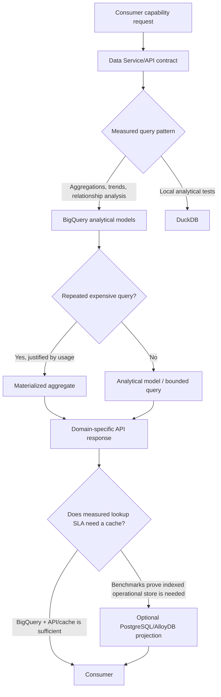

# Query patterns and routing

Choose serving paths from measured consumer requirements, not from a preferred
database. Query-pattern discovery and benchmarks precede any PostgreSQL/AlloyDB
decision. On GCP, BigQuery is the first analytical implementation; first test
whether BigQuery with an API and cache meets operational lookup requirements.

## Capability routing

The diagram is a decision model, not an implemented router. Consumers use stable
domain capabilities rather than learning whether results came from BigQuery,
PostgreSQL, Parquet, a cache, a knowledge graph, or a materialized aggregate.

## Representative workloads

Benchmark and record metadata and analytical workloads separately:

| Category | Representative workload |
| --- | --- |
| Metadata | DOI → work; OpenAlex ID → entity; eISSN/ISSN → source; publisher metadata |
| Analytics | Unique authors for a journal or publisher; publisher + topic article count |
| Analytics | Publisher + topic + license + year; institution/topic relationships |
| Analytics | Citation/reference relationships; publication and open-access trends |

For every workload, record latency, expected concurrency, data scanned, cost,
result size, freshness, frequency, and materialization suitability. Include
pagination, limits, consistency, and sync/async expectations in consumer
requirements. Bind SQL parameters; do not expose unrestricted raw SQL as the
primary application/product API.

Example domain capabilities include `GET /works/{doi}`,
`GET /sources/{eissn}`, `GET /publishers/{publisherId}`, and
`GET /journals/{journalId}/metrics`. These are consumer-contract examples, not
implemented endpoints.

## Operational-store gate

PostgreSQL/AlloyDB is optional, not a default destination for all canonical data.
Consider it only when measured requirements such as very low-latency DOI lookup,
high-frequency OpenAlex ID lookup, eISSN/ISSN metadata lookup, high-concurrency API
traffic, or repeated indexed point queries are not met by BigQuery plus API/cache.
Do not automatically copy high-volume work-author, work-topic,
work-institution, or citation/reference relationships into an operational store.

For the DOI and Work-ID lookups this gate was not met. In #118 (the operator's
personal DEV project, synthetic ~10k Works, an in-process cache) BigQuery + cache
MISSED the operator-stated 200 ms p95 with a cold cache and MET it prewarmed,
and #23 closed not_planned after the operator chose the BigQuery + API/cache
path. The local PostgreSQL Work lookup projection (#112) stays an unapproved,
undeployed PROTOTYPE.

## Materialized aggregates

Materialize only after repeated expensive analytical usage is observed. Candidate
outputs include these Step 16 Gold marts (the
[inventory](gold-analytical-marts.md#inventory) lists every mart); none is
materialized:

- `journal_author_stats`: source (journal) ID, unique author count, and ACTIVE
  work count.
- `publisher_topic_year_stats`: publisher ID, topic ID, publication year, and
  ACTIVE work count.
- `publisher_topic_license_year_stats`: publisher ID, topic ID, primary-location
  license, publication year, and ACTIVE work count.

No mart has a citation count, a first or latest publication year, or a unique
author count at the publisher/topic grain. Materialization and refresh are
tracked in DE-17 (#138).

Evaluate freshness, rebuild/reprocessing behavior, storage and query cost, and
relationship fan-out before publishing an aggregate.
