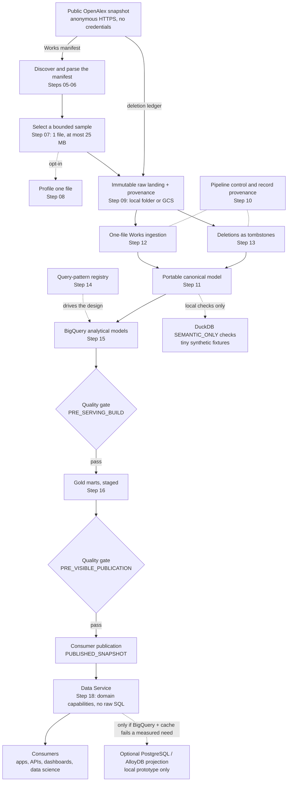

# How it works

This page follows one OpenAlex Works file from the public snapshot to a
consumer. Each section explains one stage in a paragraph or two and links to
the page with the full contract.

## The flow at a glance

This is the **target** flow. It is not a picture of running infrastructure.
Every stage exists as code with offline tests. The bounded end-to-end runner
(Step 19) executes the whole chain locally, with DuckDB standing in for the
analytical layer (`SEMANTIC_ONLY`). The cloud evidence so far covers GCS
landing, the BigQuery models and a BigQuery + in-process cache lookup
measurement (#118), on synthetic data only. Nothing is deployed
to production, and no scheduler runs this flow. [Status](status.md) has the
details.

The diagram shows how data flows. The sections below follow the build order
instead, so each idea is explained before a later stage relies on it. "Step
NN" always means a step of the 21-step [roadmap](../architecture/roadmap.md),
and "#NN" is a GitHub issue or pull request.

The orchestration contracts (Step 20) fix the order of these stages. The two
quality gates sit between the analytical build, the Gold build and consumer
visibility, and no path reaches consumers without passing both.

## Three engines, three roles

| Engine | Role | What its results prove |
| --- | --- | --- |
| **BigQuery** | The first analytical implementation on GCP. It holds the high-volume relationships and the analytical models | Dialect, cost-guard behaviour (dry run and `maximum_bytes_billed`), pruning and latency, only for the scale and project where it ran. Cost figures so far are billing-floor artifacts ([recorded runs](../architecture/bigquery-analytical-models.md#recorded-run-103)) |
| **DuckDB** | Local validation and prototypes on tiny synthetic fixtures, labelled `SEMANTIC_ONLY` | Logic only: grains, ACTIVE filtering, citation and license rules, fan-out safety. It does **not** prove BigQuery syntax, partition pruning, clustering, cost or latency ([validation kinds](../architecture/bigquery-analytical-models.md#separation-of-validation-kinds)) |
| **PostgreSQL / AlloyDB** | Optional. A selective operational projection, considered only if BigQuery plus an API/cache fails a measured requirement. It never receives a copy of every analytical relationship | Today: a local read adapter validated against local PostgreSQL (`LOCAL_POSTGRES_VERIFIED`), and a local lookup `PROTOTYPE` for #23 whose gate was **not** met; #23 was closed as not planned ([operational-store gate](../architecture/query-routing.md#operational-store-gate)). Separately, local PostgreSQL backs the durable control and canonical stores of the Step 12–13 runs (`--backend postgres`). That is local pipeline state, not a serving store or a production control plane |

The reasoning is on [GCP: BigQuery-first](../architecture/gcp-bigquery-first.md)
and [Query routing](../architecture/query-routing.md). Spark/Dataproc and
Iceberg/BigLake remain optional future choices, to revisit only if measured
needs warrant them.

## Foundation (Steps 01–04)

The first four steps set up what every later stage builds on.

- **Step 01** is the Python package, typed interfaces, structured logging,
  tests and CI.
- **Step 02** is the configuration framework. Settings live in validated YAML
  files, such as `config/local.yaml` (the safe offline default) and
  `config/gcp-sandbox.yaml` (the cloud shape, filled from environment
  variables). The environment is always selected explicitly, and sample
  limits are strict. `config/dev.yaml`, `qa.yaml` and `prod.yaml` are
  local-only placeholders, and the manual cloud scripts take their settings
  from `GOOGLE_CLOUD_PROJECT` and their own flags, not from any file in
  `config/`.
- **Steps 03 and 04** define the storage contract (`ObjectStore`) and the
  read-only query contract (`Warehouse`). The GCS, BigQuery, DuckDB and
  PostgreSQL adapters all implement these two contracts.

Details: the README's
[step table](../../README.md#roadmap-completion-status) and
[Environment readiness](../architecture/environment-readiness.md#configuration).

## Sources and sampling (Steps 05–08)

This stage finds out which files OpenAlex publishes and picks one small file
to work on, without downloading anything large.

OpenAlex publishes a public snapshot with separate `jsonl/` and `parquet/`
prefixes, and a per-entity `manifest.json` that lists every data file. The
connector reads only the manifest for the chosen format. It uses anonymous
HTTPS to the fixed public bucket host, sends no credentials, follows no
redirects and caps the manifest read at 1,000,000 bytes. A parser turns the
manifest into validated metadata, and each file gets a stable `asset_id`
derived from its identity fields. The `asset_id` names the file. It is
**not** a checksum of the file's contents.

The sample selector then picks at most **1 file of at most 25,000,000 bytes**
(the defaults). Ranking is deterministic, smallest first, and every excluded
file gets one reason code. A file of unknown size is excluded rather than
treated as zero. A separate, opt-in profiler can inspect one selected file and
label every fact with an evidence class. A real JSONL/Parquet Works pair was
profiled only in a LOCAL bounded inspection from a sandbox container on
2026-10-16 (#126), with byte caps enforced in code; the earlier opt-in run in a
cloud environment was blocked by its DNS firewall.

Details: [OpenAlex discovery and manifest contract](../architecture/openalex-manifest-contract.md),
[Source profiling](../architecture/openalex-source-profiling.md),
[Public data sources](../architecture/public-data-sources.md).

## Raw landing (Step 09, GCS via #9)

This stage stores the exact bytes that were downloaded, once and forever, so
every later step can be replayed from them.

The bytes go under a deterministic key
(`openalex/<entity>/snapshot_date=…/updated_date=…/<asset-id>/source.<ext>`).
A provenance record sits next to them, holding the run, the source and its
URI, the retrieval time and the SHA-256 checksum. Writes are create-only.
Replaying identical content does nothing, and different content or
provenance fails with a conflict error. Nothing is ever overwritten. Reads
re-verify the checksum before returning the data.

There are two implementations of the same `ObjectStore` contract: a local
folder, which publishes with an atomic directory rename, and Google Cloud
Storage (GCS), which uses a create-only precondition and keeps provenance in
object metadata. The GCS adapter has passed live smoke tests in a sandbox
project (#91), again as a least-privilege service account (#108 Stage 1), and
in personal DEV and QA projects (#108 Stage 3).

Details: [Immutable raw landing](../architecture/immutable-local-landing.md).

## Control and provenance (Step 10)

This stage keeps track of which files have been processed, by whom, and which
file every stored record came from.

The retrieval provenance above never changes. Workflow state, which does
change, is kept apart from it. `PipelineRun` tracks each run, and
`SourceFileControl` tracks each file through `DISCOVERED` → `PROCESSING` →
`SUCCESS` or `FAILED`. Before a worker processes a file it **claims** it: a
claim token plus a time-limited lease says which worker owns the file.
Retries are explicit, and stale claims are recovered explicitly. Registering
the same file again is classified, for example as `ALREADY_SUCCESS` or
`CHECKSUM_CONFLICT`, rather than repeated.

`RecordProvenance` links every canonical record to its source file, checksum
and run. That completes the lineage chain from source file to record. Control
writes go to a control store (in memory, or `PostgresControlStore` for durable
local runs), never through the read-only `Warehouse` query interface. Most go
through the `ControlStore` protocol. The Step 12–13 one-transaction
publishers are the exception: on PostgreSQL they call the store's internal
update methods inside the same transaction, and deletion events are written by
the deletion unit of work (the protocol has no deletion-event method).
No production control store exists yet (tracked in #133):
[ADR 0001 D4](../adr/0001-gcp-architecture-and-service-selection.md#d4-durable-control-plane-cloud-sql-for-postgresql-control-state-only)
(status in the [ADR index](../adr/README.md)) selects Cloud SQL for PostgreSQL for control state only, adopted only
after the DE-12 gates pass.

Details: [Pipeline control](../architecture/pipeline-control.md).

## Canonical model (Step 11)

This stage defines the portable shape that OpenAlex records are turned into,
independent of any one database.

The canonical model normalizes OpenAlex into separate entities (works,
authors, institutions, sources, publishers, topics, funders) and relationship
tables. Most relationship tables are keyed by the item's position in the
source array, such as `work_authors (work_id, authorship_index)`.
`work_topics` and `work_keywords` are keyed by `topic_id` and `keyword_id`
instead, with duplicates removed. PyArrow schemas are the source of truth,
independent of BigQuery or PostgreSQL physical design. Relationships are kept
separate and never flattened into one wide table.

The model is strict about gaps. Array fields carry `MISSING` / `NULL` / `EMPTY`
/ `PRESENT` presence flags. Malformed Work IDs fail mapping, identifiers are
never invented, and dates must be exact `YYYY-MM-DD`. Version precedence and the
reconciliation of shared entities are deterministic. The mapping is based on
OpenAlex's public documentation. The 2026-10-16 LOCAL inspection (#126) found
that it rejected all 2,798 records of the profiled 2026-09-28 file (ISO
timestamps, institution hosts); that gap is handed to DE-10 (#131) and DE-08
(#129).

Details: [OpenAlex canonical model](../architecture/openalex-canonical-model.md).

## Ingestion and deletions (Steps 12–13)

This stage reads one landed file into canonical rows, and applies OpenAlex's
list of deleted Works, without ever losing or silently reviving a record.

**Works ingestion** handles one file per run. The CLI requires an explicit
backend, `memory` or `postgres`. The run is created and the file is
registered and claimed (Step 10). After that, the raw bytes are landed
outside the database (Step 09). Then one database transaction re-checks the
claim, streams bounded JSONL records, maps each to canonical rows (Step 11),
upserts them with record-level provenance and marks the file `SUCCESS`. Any
failure rolls back every row. The raw bytes stay, and a retry reruns only the
database transaction. The docs are explicit that raw storage and PostgreSQL
are **not** one distributed ACID transaction.

**Deletions** come from OpenAlex's `deleted_ids.csv.gz` ledger (documented as
cumulative; not proven),
which is landed immutably like any other file and applied in one transaction.
Deleted Works are **tombstoned** (`activity_state = DELETED`), never physically
removed. Each row's `deleted_date` decides precedence. A newer active record
after a tombstone raises an error that requires an explicit restore, instead
of silently bringing the Work back. The relationship rows of a deleted Work
are kept and filtered out through the parent Work ("Policy A"). The full
public ledger, 234,102,326 bytes for the 2026-10-14 release (LOCAL bounded
inspection, #126), is not ingested by the local runner.

Details: [Local Works ingestion](../architecture/local-works-ingestion.md),
[OpenAlex deletions](../architecture/openalex-deletions.md).

## Query patterns and placement (Step 14)

This stage writes down, before any database design, what consumers are
expected to ask and where each question should be answered.

Step 14 recorded a typed registry of 12 OpenAlex workloads: DOI and OpenAlex
ID lookup, ISSN lookup, publisher lookup, unique authors per journal or
publisher, publisher × topic (× license × year) counts, institution/topic and
citation relationships, and publication and open-access trends. Each pattern
records its result **grain**, its **fan-out** risk, a **placement** and an
**evidence status**.

Placement follows a fixed decision order. First, can BigQuery satisfy it? If a
query is expensive and reused, it becomes a materialization candidate. If
lookup latency matters, evaluate BigQuery plus a cache. Only a *measured*
failure of that path justifies `OPTIONAL_OPERATIONAL_STORE`, and the typed model
rejects that placement without `MEASURED` evidence. ISSN/eISSN lookup stays
`UNRESOLVED`, because the canonical model holds only `issn_l`.

Details: [Query-pattern registry](../architecture/query-pattern-benchmarks.md),
[Query routing](../architecture/query-routing.md).

## BigQuery models and publication (Step 15)

This stage defines the BigQuery tables and the rules for publishing new data
into them safely and cheaply.

Step 15 defines the BigQuery Standard SQL contracts: 15 tables (7 entity
tables, 8 relationship tables), their grains, partitioning and clustering, and
query SQL for 11 of the 12 Step 14 patterns (ISSN/eISSN lookup stays
`UNRESOLVED`). `works` is integer-range partitioned on `publication_year`, so
year-bounded queries can prune. Relationship tables partition on the lineage
date. Every table keeps lineage columns, and DELETED Works stay in the
tables. Consumer queries filter `ACTIVE` explicitly.

Publication is careful about precedence. A single frozen decision table
classifies every incoming Work **before** the merge, as `INSERT`, `IDENTICAL`,
`APPLY_UPDATE`, `STALE`, `CONFLICT` or `RESTORE_REQUIRED`. The `works` MERGE
applies those decisions without reclassifying. Relationship tables are replaced
per Work inside a BigQuery transaction, and only for eligible Works. So far
only `work_topics` has that REPLACE SQL; the other relationship and dimension
tables have no publication SQL yet (tracked in #135). Cost
guards are built into the BigQuery adapter: a dry run first, then a hard
`maximum_bytes_billed` cap. The models were deployed and measured in the
sandbox on about 10k synthetic Works (#103), then at about 100k (#108
Stage 2), and in DEV and QA at about 10k (#108 Stage 3).

Details: [BigQuery analytical models](../architecture/bigquery-analytical-models.md),
[GCP: BigQuery-first](../architecture/gcp-bigquery-first.md).

## Gold marts (Step 16)

This stage defines the consumer-facing summary tables, built so that
multi-valued relationships never inflate the counts.

There are nine Gold marts, for example `research_discovery` (one row per
Work), `journal_author_stats`, `publisher_topic_year_stats` and
`citation_edges`. Each declares a grain and filters to ACTIVE Works.
Multi-valued dimensions are aggregated independently and then joined at the
mart's grain, so authors × topics × locations never multiply. License metrics
use the primary location only, and a citation target may be missing or
deleted.

Each mart is either `COMPUTE_ON_READ` or a `MATERIALIZATION_CANDIDATE`. **None
is `MATERIALIZED`.** Promotion needs `MEASURED` BigQuery evidence of repeated
cost, latency or reuse, and fixtures or preference alone cannot promote a mart.

Details: [Gold analytical marts](../architecture/gold-analytical-marts.md).

## Data quality (Step 17)

This stage decides whether data is good enough to show consumers, and blocks
it when it is not.

Quality checks come in two kinds. A `HARD_GATE` blocks publication unless it
passes, typically with an exact violation count of zero. An
`INFORMATIONAL_METRIC` is only reported, for example the share of ACTIVE Works
without a DOI. Hard gates run at two stages. `PRE_SERVING_BUILD` covers
canonical integrity and counter reconciliation. `PRE_VISIBLE_PUBLICATION`
checks that no staged Gold output contains a deleted source Work.

The rules fail closed. A check that cannot run is `ERROR`, never `PASS`, and a
missing table is not an empty table. Callers cannot redefine or skip a
required gate at runtime. Quality code only observes. It never repairs data,
fills gaps or resurrects Works.

Details: [Data quality](../architecture/data-quality.md).

## Data Service and serving (Step 18, #23, #118)

This stage is how consumers ask for data: a fixed set of typed questions
rather than raw SQL.

The Data Service is a storage-independent domain layer. It exposes five typed
capabilities (`work_metadata_lookup`, `research_discovery`, `journal_metrics`,
`publisher_summary`, `publisher_topic_analytics`), backed logically by Gold
marts. Requests are strict models that reject unknown fields, pagination uses
opaque cursors, and error codes are safe to show consumers. It serves only the
quality-approved `PUBLISHED_SNAPSHOT`, only ACTIVE Works, and freshness is
`UNKNOWN` unless the evidence says otherwise. There is no raw-SQL method, and
there is **no HTTP deployment**. Today it runs against an in-memory reference
repository.

The intended first serving approach is **BigQuery + Data Service + optional
cache**. Two pieces of work tested whether that is enough for point lookups:

- **#23, a local PostgreSQL work-lookup `PROTOTYPE`.** It was built at the
  operator's request ahead of the evidence. Its gate was **not** met, it is
  not approved, and it is never deployed.
- **#118, an in-process TTL/LRU cache with a manual BigQuery + cache
  measurement script.** The target it measures against is an operator-stated
  requirement of 200 ms p95, recorded in #119, which is not a validated Wiley
  SLA. Four runs, in the personal DEV project on synthetic data, are recorded
  in the #118 issue comments. With a cold cache, both the DOI and the Work-ID
  lookup **missed** the target (2,426 ms and 2,554 ms p95). With every key
  prewarmed (`--prewarm`), both **met** it (0.006 ms and 0.010 ms p95). Each
  cache miss costs seconds through BigQuery, so the result depends on the
  share of requests that miss. The cache was in-process around
  `BigQueryWarehouse.query`, with no Data Service, API or shared cache in the
  path, so this is not a production latency. The code is
  [`lookup_cache.py`](../../src/research_platform/serving/lookup_cache.py) and
  [`lookup_cache_measure_118.py`](../../scripts/lookup_cache_measure_118.py).

On that evidence the operator chose the BigQuery + API/cache path for DOI and
Work-ID lookups, assuming a small, hot working set, and closed #23 as not
planned. Nothing is deployed: there is no HTTP API and no shared cache. A
production-aware lookup cache is tracked in #151, and the Data Service API in
#149.

Details: [Data Service](../architecture/data-service.md),
[Work lookup projection (#23)](../architecture/serving-work-lookup-projection.md),
[PostgreSQL Warehouse](../architecture/postgres-warehouse.md).

## Orchestration, end to end (Steps 19–21)

This stage runs everything above as one bounded pipeline, describes how a
scheduler would run it, and records how ready each environment is.

**Step 19** is the bounded end-to-end runner. It runs every stage above under
one outer `PipelineRun`, with DuckDB in place of BigQuery. It activates the
consumer publication atomically and then validates it. If final validation
fails, the previous publication is restored. Its evidence label is always
`SEMANTIC_ONLY`.

**Step 20** turns that into orchestration *contracts*. No Airflow, Composer
or Dataform is deployed. The contracts cover:

- a logical task graph, and the physical execution units that run it;
- small messages passed between tasks (the future Airflow XCom payloads);
- retries and bounded backfills;
- how concurrent BigQuery publications avoid sharing scratch tables
  (`TEMP_TABLES` is recommended).

REGISTER, INGEST and CANONICALIZE are logical phases of one
`WORKS_INGEST_UNIT`, because Step 12 already does them as one transactional
unit.

**Step 21** adds the environment readiness registry and promotion gates
described on the [Status](status.md#environment-readiness) page.

Details: [End-to-end pipeline](../architecture/end-to-end-pipeline.md),
[Orchestration](../architecture/orchestration.md),
[Environment readiness](../architecture/environment-readiness.md).
